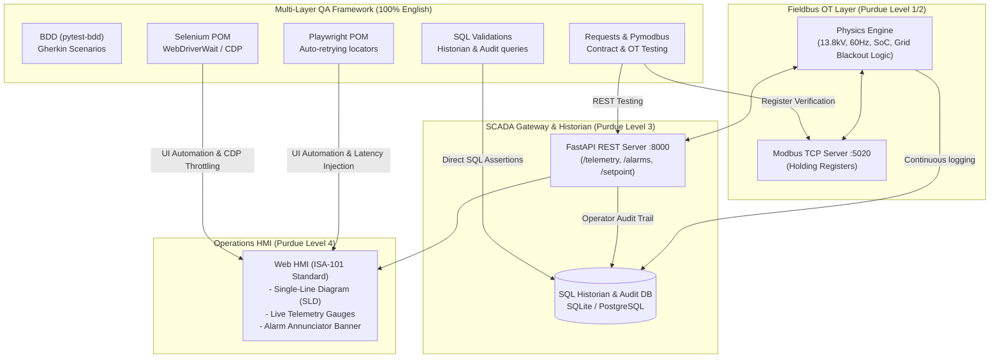

# Industrial SCADA BESS & MV-UPS Test Automation Framework

An enterprise-grade QA Test Automation Framework and industrial simulation lab modeling a medium-voltage (13.8 kV) uninterruptible power supply and Battery Energy Storage System (BESS) functioning as an electrical and physical firewall between utility grids and mission-critical data centers.

---

## 1. Architectural Highlights



### Architecture & QA Verification Matrix (Purdue Model Mapping)

For environments with text-only terminals (or before GitHub renders the Mermaid diagram above), the table below details how each industrial layer is simulated and verified by the test automation framework:

| Purdue Level | Domain / Layer | System Component | Protocols & Tech | QA Automation Strategy | Tools Used |
| :--- | :--- | :--- | :--- | :--- | :--- |
| **Level 4** | **Operations HMI** | Web Dashboard, SVG Single-Line Diagram, Alarm Banner | HTML5, SVG, CSS (ISA-101 Dark), JavaScript polling | End-to-End browser automation with POM, handling slow UI polling, stale DOM nodes, and high-latency simulation | **Playwright** (auto-wait) & **Selenium** (explicit `WebDriverWait`) |
| **Level 3** | **SCADA Gateway** | Supervisory REST API & Operator RBAC | FastAPI, Python, JWT, PBKDF2 | Boundary Value Analysis (BVA), HTTP contracts, role-based authorization (401/403), and chaos retries | **Requests**, **Pytest**, **Postman** |
| **Level 3** | **Historian DB** | Continuous Time-Series & Sequence of Events (SOE) | SQLite / PostgreSQL, SQLAlchemy | Direct SQL assertions verifying continuous telemetry persistence, AVG/MIN/MAX aggregations, and NERC-CIP operator audit trails | **SQLAlchemy**, **Pytest** |
| **Level 1 / 2** | **Fieldbus (OT)** | Medium-Voltage Breakers, BESS Inverter, Grid Sensors | Modbus TCP (Port 5020), Holding Registers | Direct industrial fieldbus socket inspection validating electrical scaling (13.8kV, 60Hz, breaker trip states) | **Pymodbus** |
| **Cross-Tier** | **Acceptance Layer** | Grid Firewall Isolation & Safety Rules | Gherkin Specification | Business-readable acceptance criteria executed against technical Page Objects | **pytest-bdd** |

### Key Capabilities
* **Purdue Model Multi-Tier Testing**: Tests across Fieldbus (Modbus TCP port 5020), REST API (port 8000), SQL Historian database, and ISA-101 Web HMI.
* **Dual UI Automation Engines (Playwright & Selenium)**: Page Object Model (POM) implemented cleanly in both frameworks to demonstrate modern auto-waiting vs explicit `WebDriverWait` polling.
* **Zero-Sleep Flakiness Policy**: Eliminates arbitrary `time.sleep()`. All synchronization relies on web-first assertions and resilient polling predicates to handle slow industrial UIs.
* **Client-Side Network Simulation**: Custom Pytest fixtures utilizing Playwright `page.route` and Chrome DevTools Protocol (CDP) to inject latency, dropped packets, and HTTP 504 timeouts against **both local containers and remote staging servers**.
* **Behavior-Driven Development (BDD)**: Gherkin feature files (`.feature`) executed via `pytest-bdd` connecting domain acceptance criteria with technical Page Objects.
* **Database & SQL Validations**: Direct SQL assertions verifying continuous time-series logging in the Historian and operator action tracking in `control_audit_log` (NERC-CIP compliance).
* **Multi-Environment Agnostic**: One single command targets local dev, multi-container Docker bridges, or remote staging services (`--env=local|docker|staging`).

---

## 2. Directory Structure

```text
scada-lab/
├── .agents/
│   ├── rules/
│   │   ├── coding_standards.md          # 100% English, PEP8, strict typing, Google docstrings
│   │   └── testing_guidelines.md        # Test markers, POM rules, zero-sleep policy
│   └── skills/
│       └── network-fault-fixtures/
│           └── SKILL.md                 # Runbook for network chaos & throttling fixtures
├── AGENTS.md                            # Workspace agent instructions & directives
│
├── app/                                 # System Under Test (SUT)
│   ├── core/
│   │   ├── auth.py                      # PBKDF2 hashing, JWT generation & RBAC dependencies
│   │   ├── ups_simulator.py             # BESS & MV-UPS physics engine (13.8kV, SoC, Alarms)
│   │   ├── modbus_server.py             # Modbus TCP Server (port 5020)
│   │   ├── chaos_middleware.py          # Configurable latency/jitter injection for REST routes
│   │   └── database.py                  # SQLAlchemy Historian & Event models
│   ├── api/
│   │   ├── auth_routes.py               # /api/v1/auth/login, /api/v1/auth/me
│   │   ├── routes.py                    # REST endpoints (/telemetry, /alarms, /setpoints)
│   │   └── schemas.py                   # Pydantic schemas (English)
│   ├── static/                          # Industrial Web HMI
│   │   ├── index.html                   # Single-Line Diagram (SLD) & Alarm Annunciator
│   │   ├── styles.css                   # Dark theme adhering to ISA-101 standard
│   │   └── app.js                       # Auth state handling, polling and control actions
│   └── main.py                          # App orchestrator (FastAPI + Modbus thread + DB init)
│
├── tests/                               # Test Automation Framework (100% English)
│   ├── config.py                        # Multi-environment configuration manager
│   ├── conftest.py                      # Global fixtures (environment loader, base URLs, auth)
│   ├── fixtures/
│   │   ├── auth_fixtures.py             # Pre-authenticated contexts, tokens & user fixtures
│   │   ├── network_playwright.py        # Client-side Playwright route latency & abort fixtures
│   │   ├── network_selenium.py          # Client-side Selenium CDP network emulation fixtures
│   │   └── chaos_api.py                 # REST API chaos and retry fixtures
│   ├── pages/                           # Page Object Model
│   │   ├── base_page_pw.py              # Playwright base page (auto-retrying assertions)
│   │   ├── base_page_se.py              # Selenium base page (WebDriverWait & Stale handlers)
│   │   ├── login_page_pw.py             # Playwright Login Page Object
│   │   ├── login_page_se.py             # Selenium Login Page Object
│   │   ├── dashboard_page_pw.py         # Playwright SLD & live telemetry meters
│   │   └── dashboard_page_se.py         # Selenium SLD & live telemetry meters
│   ├── bdd/                             # Behavior-Driven Development (pytest-bdd)
│   │   ├── features/
│   │   │   ├── operator_auth.feature    # Gherkin: Operator login & RBAC permissions
│   │   │   └── grid_safety.feature      # Gherkin: Islanding data center on grid fault
│   │   └── step_defs/
│   │       ├── test_auth_steps.py
│   │       └── test_grid_safety_steps.py
│   ├── db/                              # SQL & Database Validations
│   │   ├── test_telemetry_historian.py  # SQL assertions on continuous time-series metrics
│   │   └── test_operator_audit_trail.py # SQL assertions on logged operator actions
│   ├── e2e_playwright/                  # Playwright End-to-End Suite
│   │   └── test_pw_scenarios.py
│   ├── e2e_selenium/                    # Selenium End-to-End Suite
│   │   ├── conftest.py
│   │   └── test_se_scenarios.py
│   └── api/                             # API & Protocol Test Suite
│       ├── test_auth_api.py             # Login, token validation, 401/403 responses
│       ├── test_modbus_registers.py     # Direct Modbus TCP holding register validation
│       └── test_rest_telemetry.py       # REST API contracts, bounds, and error codes
│
├── docs/                                # QA Documentation & Portfolio Assets
│   ├── test_plan.md                     # Test strategy, BVA & Equivalence Partitioning matrices
│   └── jira_defect_samples.md           # Realistic production JIRA defect tickets
│
├── postman/
│   └── scada_api_collection.json        # Exportable Postman collection with Auth tests
│
├── .github/
│   └── workflows/
│       └── qa_pipeline.yml              # CI/CD GitHub Actions workflow
│
├── docker/
│   ├── Dockerfile.app                   # Container for SCADA Core + Web HMI + DB
│   └── Dockerfile.tests                 # Container for Pytest + Headless Browsers
├── docker-compose.yml                   # Multi-service local test orchestration
├── requirements.txt                     # Pinned Python dependencies
├── pytest.ini                           # Pytest config, markers, and test paths
└── README.md                            # Comprehensive master documentation
```

---

## 3. Quickstart & Execution Guide

### Option A: Local Development Setup (Recommended for Interactive Debugging)

```bash
# 1. Clone repository and navigate to folder
cd scada-lab

# 2. Create and activate virtual environment
python3 -m venv .venv
source .venv/bin/activate

# 3. Install dependencies and Playwright Chromium
pip install -r requirements.txt
playwright install chromium

# 4. Run the SCADA Application locally
python -m app.main
```
Open your browser at **`http://localhost:8000`** to interact with the live ISA-101 SCADA Control Room HMI.
* **Operator Account**: `operator_alice` / `ControlRoom2026!` (Full control clearance)
* **Viewer Account**: `viewer_guest` / `Readonly2026!` (Read-only monitoring)

---

### Option B: Multi-Container Docker Stack (Hermetic CI/CD Parity)

```bash
# Run SCADA Core and Automated Test Runner in isolated Docker containers
docker compose up --build --abort-on-container-exit --exit-code-from test-runner
```
All HTML reports and trace artifacts are automatically written to `./reports` on your host machine.

---

## 4. Running Test Suites

All tests automatically manage the local application lifecycle via the `live_server` fixture if the server is not already running.

### 4.1 Running the Entire Test Suite
```bash
pytest -v
```

### 4.2 Running Layer-Specific Suites
```bash
# REST API & Authentication tests
pytest tests/api/test_auth_api.py tests/api/test_rest_telemetry.py -v

# Industrial Fieldbus Modbus TCP register tests (Purdue Level 1/2)
pytest tests/api/test_modbus_registers.py -v

# SQL Database & Industrial Historian validations
pytest tests/db/ -v

# Behavior-Driven Development (BDD Gherkin acceptance criteria)
pytest tests/bdd/ -v

# Playwright E2E UI Tests (with auto-waiting and network delay testing)
pytest tests/e2e_playwright/ -v

# Selenium E2E UI Tests (with explicit WebDriverWait and CDP throttling)
pytest tests/e2e_selenium/ -v
```

### 4.3 Running with Visual Headed Browsers & Slow Motion
```bash
# Watch Playwright interact with the SCADA HMI in real time:
pytest tests/e2e_playwright/ --headed --slowmo 400
```

### 4.4 Targeting a Remote Staging / QA Web Service
```bash
# Run tests against an external staging server without local containers:
pytest tests/e2e_playwright/ --env=staging --base-url=https://staging-scada.datacenter.internal
```

---

## 5. Network Interference & Flakiness Simulation

Industrial networks (satellite, cellular, radio) frequently suffer from latency spikes and packet loss. This framework provides three levels of deterministic fault injection:

1. **Playwright Route Delay (`slow_telemetry_network`)**:
   Intercepts browser polling calls (`/api/v1/telemetry`) and adds 1.5 seconds of artificial delay. Verifies that Playwright's auto-retrying locators await state resolution without failing.
2. **Selenium CDP Throttling (`throttled_network_selenium`)**:
   Emulates an edge cellular link (1500ms RTT, 512 kbps) using Chrome DevTools Protocol. Verifies that explicit `WebDriverWait` polling handles slow DOM repaints.
3. **REST Chaos Adapter (`transient_503_session`)**:
   Injects synthetic HTTP 503 Service Unavailable errors on the first N calls to validate client exponential backoff and retry policies.

---

## 6. QA Deliverables & Documentation

* **Test Strategy & Design**: See [`docs/test_plan.md`](docs/test_plan.md) for Boundary Value Analysis (BVA) matrices on power setpoints and Equivalence Partitioning (EP) on medium-voltage levels.
* **Production Defect Tracking**: See [`docs/jira_defect_samples.md`](docs/jira_defect_samples.md) for production-grade JIRA bug reports detailing industrial race conditions, audit log attributions, and debounce fixes.
* **Postman API Collection**: Import [`postman/scada_api_collection.json`](postman/scada_api_collection.json) directly into Postman for automated JavaScript-backed request verification.
* **CI/CD Automation**: Inspect [`.github/workflows/qa_pipeline.yml`](.github/workflows/qa_pipeline.yml) for GitHub Actions workflow definitions.

---

## 7. Technical Architecture & Engineering Q&A

* **Q: Why are industrial SCADA web UIs often perceived as slow, and how does your framework prevent flaky tests?**
  * *Answer*: Industrial HMIs continuously poll field controllers or push updates via WebSockets, triggering periodic DOM re-renders without virtual DOM reconciliation. In Selenium, this leads to `StaleElementReferenceException` if a selector captures a node right before a polling cycle replaces it. Our framework mitigates this by (1) strictly banning `time.sleep()`, (2) utilizing Playwright's auto-retrying web-first assertions which re-query the DOM on every tick, and (3) wrapping Selenium assertions in custom polling wait predicates that catch stale element exceptions.
* **Q: How does this test framework simulate network latency when testing against a remote QA environment?**
  * *Answer*: Rather than trying to modify the remote server's OS networking, we intercept traffic at the browser engine level using Playwright's `page.route` and Selenium's Chrome DevTools Protocol (`Network.emulateNetworkConditions`). This allows simulating a 2-second satellite delay or connection loss directly from the QA test runner without needing container or root access to the remote staging infrastructure.
* **Q: How do you bridge OT protocols with modern QA automation?**
  * *Answer*: In critical power systems, physical meters communicate via fieldbus protocols like Modbus TCP. Our test suite includes direct socket verification using `pymodbus` to read holding registers (voltages, frequencies, breaker trip states) alongside REST API and UI tests, guaranteeing end-to-end consistency from field registers (Purdue Level 1) up to the operator dashboard (Purdue Level 4).

